# MySpace: собираем одинаковый симулятор шаг за шагом

**Прочитайте эту инструкцию до генерации кода.** Все собирают один проект: Python + Ursina, восемь планет, камера, карточки и заметки в `data/notes.txt`. PostgreSQL и pgAdmin не используются.

Это репозиторий преподавателя с инструкцией и материалами. **Свой пустой репозиторий каждый создаёт сам.** Готовые исходники приложения здесь не опубликованы: Python-код дан изображениями для ручного набора. Откройте картинку в полном размере. Номера строк слева вводить не нужно. Изображение затрудняет копирование, но не исключает OCR. Команды терминала можно копировать.

Не меняйте имена файлов, порядок разделов, сигнатуры функций и формат данных до получения работающей v1.0: следующие шаги используют их. После приёмки можно развивать свою версию. Сам по себе порядок действий не гарантирует понимание — в конце шагов нужно объяснять и проверять результат.

## Содержание

- [0. Подготовка репозитория](#шаг-0-подготовка-репозитория)
- [1. Семь документов до начала программирования](#шаг-1-сначала-документация)
- [2. Программирование небольшими частями](#шаг-2-программирование)
- [3. Тестирование и исправления](#шаг-3-тестирование)
- [4. Публикация и защита](#шаг-4-публикация-и-защита)

## Целевой результат

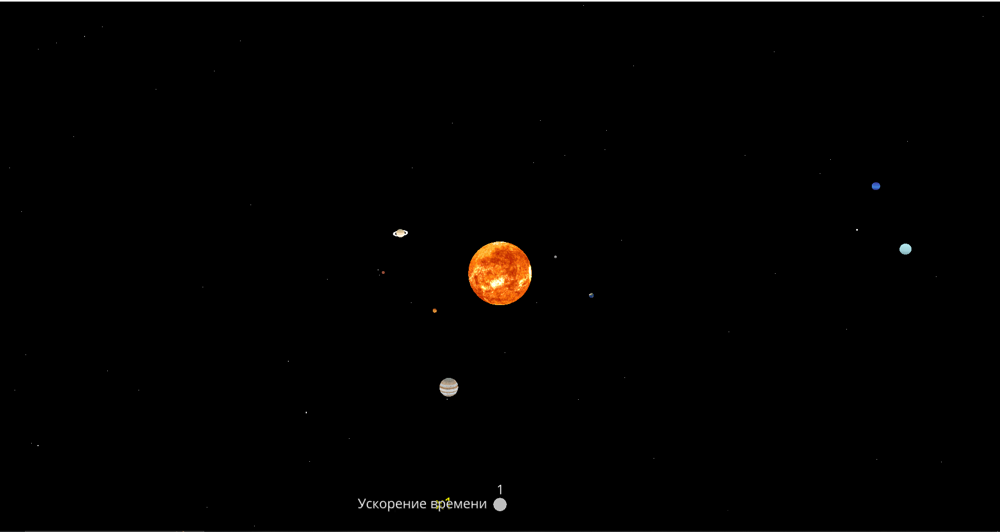

Этот скриншот — ориентир, а не точное оформление готового урока. В версии по инструкции используются условные текстуры, список планет слева, карточка и поле заметки справа. Планеты движутся; можно выбрать любую, приблизить камеру, включить паузу, изменить скорость и сохранить заметку.

Солнечная система условная: размеры, расстояния, скорости и текстуры не воспроизводят физическую модель. Факты в карточках округлены.

## Одинаковая структура у всех

```text
myspace/
├── README.md
├── .gitignore
├── requirements.txt
├── src/
│   ├── planet_data.py
│   ├── storage.py
│   ├── motion.py
│   └── main.py
├── assets/
│   └── textures/          # sun.png и восемь планет
├── data/
│   └── notes.txt          # программа создаёт при первом сохранении
├── docs/
│   ├── 01_Устав_проекта.md
│   ├── 02_План_проекта.md
│   ├── 03_Требования.md
│   ├── 04_Техническое_задание.md
│   ├── 05_Протокол_встречи.md
│   ├── 06_Отчёт_о_статусе.md
│   ├── 07_Документация_продукта.md
│   └── sources.md
├── tests/
│   ├── test_logic.py
│   └── manual_checks.md
└── screenshots/
    ├── 01-system.png
    ├── 02-earth-card.png
    └── 03-note-saved.png
```

Структура показывает **итог**, а не файлы, которые уже существуют в этом репозитории. Папки создавайте по инструкции, файлы — на соответствующем шаге. Ваши ФИО, даты, фактические результаты и история Git будут различаться; состав функций и имена файлов одинаковы.

## Как распределена работа по спринтам

- Спринт 1 (две недели): шаг 0, документы и пункты 2.1–2.5 — окно и статическая система.
- Спринт 2 (две недели): пункты 2.6–2.9 — карточки, камера, движение и заметки.
- Спринт 3 (две недели): тестирование, исправления, независимый запуск, выпуск и защита.

В конце спринта демонстрируйте именно готовую часть, обновляйте отчёт и обсуждайте один способ улучшить работу. Начальный план можно менять после согласования и записи причины.

## Шаг 0. Подготовка репозитория

### 0.1. Создайте своё место для проекта

На выбранной платформе создайте пустой репозиторий `myspace-Фамилия`. Не добавляйте автоматически README и лицензию. Скопируйте его HTTPS-адрес. Ниже пример для GitHub; на GitVerse/GitLab используйте свой адрес и подсказки своей платформы.

В терминале откройте каталог, где будут храниться проекты:

```bash
git clone АДРЕС_ВАШЕГО_РЕПОЗИТОРИЯ
cd ИМЯ_СОЗДАННОЙ_ПАПКИ
git branch -M main
git remote -v
```

Замените слова-заполнители своими значениями. `git remote -v` должен показывать **ваш**, а не преподавательский репозиторий. Если вход не выполнен, пройдите обычную авторизацию платформы; не вставляйте токены в файлы проекта.

Создайте в редакторе папки из дерева. Пока папка пуста, Git её не показывает — это нормально. `.gitkeep` не нужен, когда появляются обычные файлы.

### 0.2. Создайте .gitignore и первоначальный README

В `.gitignore` внесите построчно:

```gitignore
.venv/
__pycache__/
*.pyc
.env
.DS_Store
.idea/
.vscode/
data/notes.txt
data/notes.tmp
```

Почему заметки исключены: это личные данные пользователя, а не исходный код. Программа сама создаст файл. Текстуры и скриншоты **не исключайте**.

В README пока напишите только название, ФИО и группу, назначение, выбранный стек и статус «Документация; приложение не создано». Не заявляйте готовые функции и успешные тесты заранее.

Настройте имя автора коммитов, если Git просит об этом. Используйте свои данные:

```bash
git config user.name "Ваше имя"
git config user.email "Ваш адрес для коммитов"
```


**Зафиксируйте результат:**

```bash
git status
git add .
git commit -m "Создать репозиторий и описание проекта"
git push -u origin HEAD
```

Если проверка не пройдена, исправьте текущий шаг перед переходом дальше. Не делайте пустой коммит ради отметки.

**Проверка:** откройте собственный репозиторий в браузере — видны README и `.gitignore`, автор коммита правильный.

## Шаг 1. Сначала документация

Создайте **все семь документов до шага 2**. Сначала в них будет исходный план и шаблоны будущих записей. Фактические встречи, отчёты, скриншоты и проверки появляются только после реальной работы. Не придумывайте события.

### 1.1. Первая документация — устав проекта

Создайте `docs/01_Устав_проекта.md`. Напишите:

- Название: MySpace. Автор: ваши ФИО и группа. Заказчик: учебный центр MySpace; представитель — преподаватель.
- Проблема: по статичной картинке трудно понять движение планет и рассмотреть каждую отдельно.
- Цель: к концу трёх спринтов передать запускаемый симулятор с восемью планетами, карточками, камерой и сохранением заметок.
- Границы: входит набор функций этой инструкции. Не входят реальные гравитационные расчёты, регистрация, сервер, SQL, спутники и многопользовательский режим.
- Роли: студент совмещает руководителя, аналитика, разработчика и тестировщика; преподаватель принимает результат; одногруппник проверяет установку.
- Ресурсы: компьютер, Git, Python, Ursina, время. Укажите доступные часы в неделю, бюджет и денежные расходы отдельно от часов.
- Риски: не устанавливается движок → заранее проверить окружение; опечатки при наборе → запускать по блокам; потеря изменений → Git; потеря заметок → проверка сохранения и повторного запуска.
- Критерий успеха: другой человек запускает проект по README и выполняет проверки шага 3.

**Ответьте устно:** кто заказчик, что сдаём, чего не обещаем?
**Зафиксируйте результат:**

```bash
git status
git add docs/01_Устав_проекта.md
git commit -m "Описать устав и границы MySpace"
git push -u origin HEAD
```

Если проверка не пройдена, исправьте текущий шаг перед переходом дальше. Не делайте пустой коммит ради отметки.

### 1.2. Вторая документация — план проекта

Создайте `docs/02_План_проекта.md`. Перенесите три спринта из этой инструкции и **поставьте реальные даты**.

Для каждой задачи укажите: номер, результат, ответственный, оценка в часах, начало, конец, зависимость, способ проверки. Разбейте большие задачи: «карточка» → «выбрать объект» → «получить данные» → «показать текст и изображение».

Пример зависимости: словарь данных → создание планет → выбор планеты → сохранение её заметки. Время на тестирование и исправления включите в план.

Создайте задачи в Issues или аналогичном трекере. На доске используйте «К выполнению», «В работе», «Проверка», «Готово». Ссылку добавьте в план. Если функция платформы недоступна, ведите список задач в этом файле и укажите причину.

Нарисуйте простую диаграмму Ганта по датам, сохраните `docs/gantt.png`. Отметьте задачи, задержка которых сдвигает итоговую дату. Объясните зависимости; не называйте все задачи критическими автоматически.

**Ответьте:** что делаете первым и что задержится, если оно не готово?
**Зафиксируйте результат:**

```bash
git status
git add docs
git commit -m "Составить план трёх спринтов"
git push -u origin HEAD
```

Если проверка не пройдена, исправьте текущий шаг перед переходом дальше. Не делайте пустой коммит ради отметки.

### 1.3. Третья документация — требования

Создайте `docs/03_Требования.md`. Запишите проблему пользователя и список:

- FR-1: отображаются Солнце и восемь планет с текстурами.
- FR-2: планеты движутся; пауза останавливает их, но не камеру и карточки.
- FR-3: любую планету можно выбрать мышью или кнопкой.
- FR-4: карточка соответствует выбранной планете и содержит изображение и справочные значения.
- FR-5: камера приближается, отдаляется, поворачивается и возвращается к общему виду.
- FR-6: пользователь сохраняет заметку до 160 символов для выбранной планеты; после перезапуска заметка доступна.
- FR-7: ошибка чтения/записи заметок сообщается пользователю; отсутствие текстуры заменяется заглушкой.
- NFR-1: нет обязательного интернет-соединения во время работы приложения.
- NFR-2: интерфейс читается в окне 1280 × 720.
- NFR-3: пути не зависят от имени пользователя и каталога запуска.

Функции обязательные; дополнительные улучшения отложите до v1.0.

**Ответьте:** чем проверяемое требование отличается от «сделать красиво»?
**Зафиксируйте результат:**

```bash
git status
git add docs/03_Требования.md
git commit -m "Зафиксировать требования к системе"
git push -u origin HEAD
```

Если проверка не пройдена, исправьте текущий шаг перед переходом дальше. Не делайте пустой коммит ради отметки.

### 1.4. Четвёртая документация — техническое задание

Создайте `docs/04_Техническое_задание.md`. На основе требований укажите:

1. Состав файлов из дерева README и назначение каждого модуля.
2. Эскиз: сцена в центре, кнопки слева, карточка и заметка справа, управление временем снизу.
3. Управление: колесо — масштаб; правая кнопка — поворот; левая — выбор; пробел — пауза; R — общий вид; Esc — выход. При наборе заметки пробел и R вводят текст, а не управляют сценой.
4. Формат TXT: одна строка `earth|Моя заметка`; слева идентификатор, справа текст. UTF-8. Переносы внутри заметки заменяются пробелами. Разделение строки выполняется только по первому `|`.
5. При первом запуске файла может не быть: заметки пустые. При сохранении создаётся папка и файл. Сохранение выполняется через временный файл и замену основного.
6. Изменение планеты или выход без кнопки «Сохранить» не сохраняет набранный текст. Это ограничение обязательно написать в инструкции пользователя.
7. Ссылки на проверки FR-1…FR-7 из раздела 3 этой инструкции.

**Ответьте:** почему текстуры лежат в репозитории, а личные заметки — нет?
**Зафиксируйте результат:**

```bash
git status
git add docs/04_Техническое_задание.md
git commit -m "Описать интерфейс и формат TXT"
git push -u origin HEAD
```

Если проверка не пройдена, исправьте текущий шаг перед переходом дальше. Не делайте пустой коммит ради отметки.

### 1.5. Пятая документация — протоколы встреч

Создайте `docs/05_Протокол_встречи.md` с полями: дата, участники, тема, вопросы, решения, задачи с ответственными и сроками, следующая встреча.

Проведите короткое согласование первых четырёх документов с преподавателем. После него заполните первую запись **по факту**. Для следующих обсуждений добавляйте разделы, не стирая историю.

**Контроль:** преподаватель подтвердил тему, функции и план. Если не подтвердил — исправьте документы до кода.
**Зафиксируйте результат:**

```bash
git status
git add docs
git commit -m "Записать результаты согласования проекта"
git push -u origin HEAD
```

Если проверка не пройдена, исправьте текущий шаг перед переходом дальше. Не делайте пустой коммит ради отметки.

### 1.6. Шестая документация — отчёты о статусе

Создайте `docs/06_Отчёт_о_статусе.md`: спринт, даты, цель, сделано, в работе, проблемы, риски, план/факт часов, готовность, решения заказчика и улучшение работы.

Первая фактическая запись: «Созданы и согласованы документы; приложение не разработано». В конце каждого спринта добавляйте новую запись со ссылками на задачи и коммиты.

Готовность считайте по принятым задачам: если запланировано 40 часов и приняты задачи на 10 плановых часов, это 25%. Не считайте строки кода. Для учебного сравнения освоенного объёма можно использовать плановые часы: PV — плановый объём к дате, EV — плановая оценка принятых задач, AC — фактически затраченные часы. Подпишите, что это часы; объясните отставание и перерасход, а не только вычислите числа.

**Зафиксируйте результат:**

```bash
git status
git add docs/06_Отчёт_о_статусе.md
git commit -m "Создать отчёт о статусе и оценке трудозатрат"
git push -u origin HEAD
```

Если проверка не пройдена, исправьте текущий шаг перед переходом дальше. Не делайте пустой коммит ради отметки.

### 1.7. Седьмая документация — руководство пользователя

Создайте `docs/07_Документация_продукта.md`. Пока напишите структуру: назначение, системные требования, установка, запуск, управление, заметки, типичные проблемы, ограничения, источники. Отметьте статус «черновик; запуск ещё не проверен».

После разработки замените черновые пункты фактическими командами и изображениями. Не заявляйте, что всё работает, до проверки.

**Зафиксируйте результат:**

```bash
git status
git add docs/07_Документация_продукта.md
git commit -m "Подготовить черновик руководства пользователя"
git push -u origin HEAD
```

Если проверка не пройдена, исправьте текущий шаг перед переходом дальше. Не делайте пустой коммит ради отметки.

### Проверка перед кодом

Откройте свой репозиторий: все семь документов доступны. Объясните назначение каждого, покажите задачи первого спринта и согласование с преподавателем. Исправления оформляйте отдельным небольшим коммитом.

## Шаг 2. Программирование

### 2.1. Окружение

Начните отдельную ветку для разработки:

```bash
git switch -c feature/solar-system
```

Коммиты документации уже находятся в `main`. Изменения кода будут на этой ветке до итоговой проверки. После каждого шага отправляйте её командой `git push -u origin HEAD`. В интерфейсе платформы можно открыть запрос на слияние в main, чтобы преподаватель видел изменения; названия кнопок зависят от платформы.


Установите Python с официального сайта, используйте локальный компьютер с графическим рабочим столом. Эта программа не запускается как сайт и не требует pgAdmin.

В терминале **в корне своего проекта**:

```bash
python --version
python -m venv .venv
```

Windows PowerShell: `.venv\Scripts\Activate.ps1`. Если выполнение скриптов запрещено, используйте терминал cmd и `.venv\Scripts\activate.bat`; менять системные политики не требуется. macOS/Linux: `source .venv/bin/activate`. В этих системах команда создания окружения может называться `python3`.

Далее используйте Python активированного окружения. Запишите версии в руководство. Создайте `requirements.txt` по проверенным значениям из блока «Результаты проверки преподавателем» в конце README и установите:

```bash
python -m pip install -r requirements.txt
python -m pip check
```

**Стоп:** при ошибке установки не переходите к коду — сохраните текст ошибки и проверьте версию Python/ОС. Версия, проверенная на одном компьютере, не является гарантией для любой видеокарты и ОС.

**Зафиксируйте результат:**

```bash
git status
git add requirements.txt docs
git commit -m "Настроить зависимости проекта"
git push -u origin HEAD
```

Если проверка не пройдена, исправьте текущий шаг перед переходом дальше. Не делайте пустой коммит ради отметки.

### 2.2. Данные о планетах

Создайте `src/planet_data.py`. Кортеж каждой планеты содержит: идентификатор, имя, радиус орбиты, размер сферы, скорость анимации, диаметр, расстояние от Солнца и период обращения. Последние три значения справочные, первые параметры сцены условные. Не переставляйте столбцы.

Наберите код с изображений по порядку:

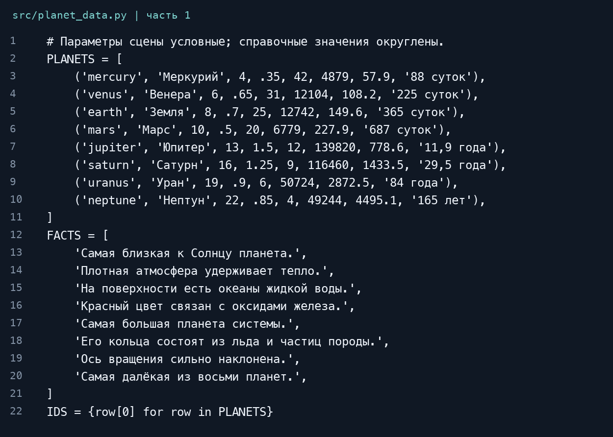

**Проверьте синтаксис:**

```bash
python -m py_compile src/planet_data.py
```

Успех — команда завершилась без сообщения об ошибке. Это ещё не проверка поведения программы. Объясните назначение каждой функции или списка в этом файле.

**Зафиксируйте результат:**

```bash
git status
git add src/planet_data.py docs
git commit -m "Добавить данные о планетах"
git push -u origin HEAD
```

Если проверка не пройдена, исправьте текущий шаг перед переходом дальше. Не делайте пустой коммит ради отметки.

### 2.3. Хранение заметок в TXT

Создайте `src/storage.py`. Это обычный текстовый файл, не SQL-база. Функция загрузки читает строки; функция сохранения сначала пишет временный файл. Последний служит защитой от частично записанного основного файла, но не заменяет резервное копирование.

Наберите код с изображений по порядку:

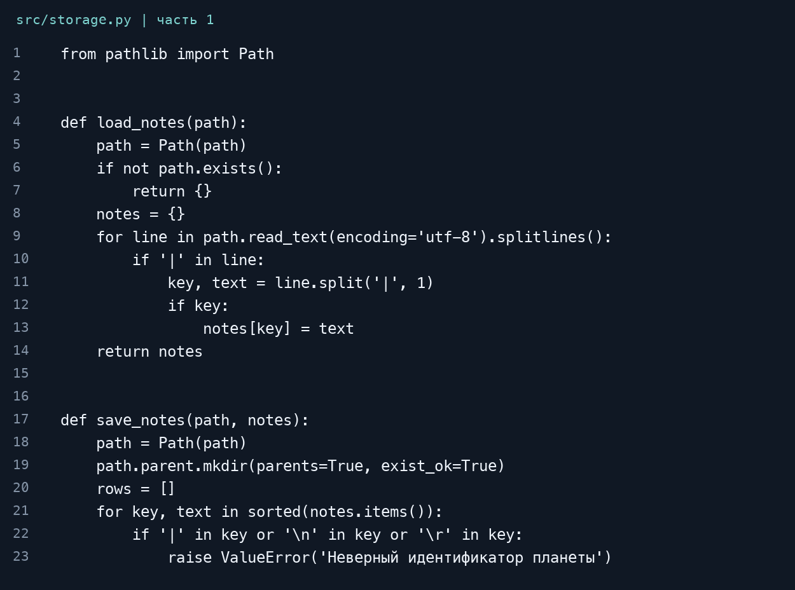

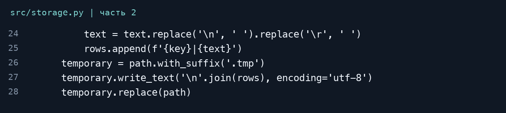

**Проверьте синтаксис:**

```bash
python -m py_compile src/storage.py
```

Успех — команда завершилась без сообщения об ошибке. Это ещё не проверка поведения программы. Объясните назначение каждой функции или списка в этом файле.

**Зафиксируйте результат:**

```bash
git status
git add src/storage.py docs
git commit -m "Добавить хранение заметок в txt"
git push -u origin HEAD
```

Если проверка не пройдена, исправьте текущий шаг перед переходом дальше. Не делайте пустой коммит ради отметки.

### 2.4. Расчёты движения и масштаба

Создайте `src/motion.py`. Функции не открывают окно: их можно проверять отдельно. Угол измеряется в градусах, для синуса и косинуса переводится в радианы. `delta` — время между кадрами, `multiplier` — ускорение, `paused` — состояние паузы.

Наберите код с изображений по порядку:

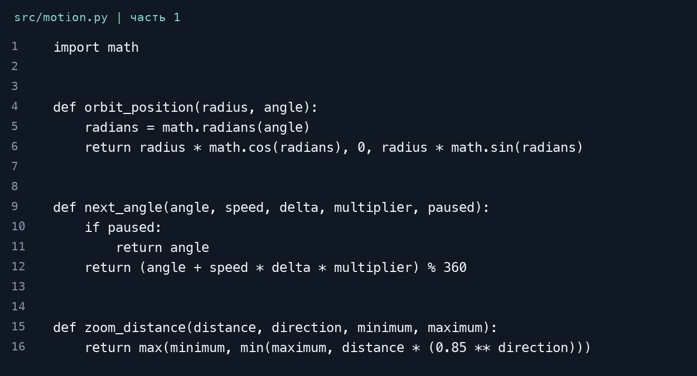

**Проверьте синтаксис:**

```bash
python -m py_compile src/motion.py
```

Успех — команда завершилась без сообщения об ошибке. Это ещё не проверка поведения программы. Объясните назначение каждой функции или списка в этом файле.

**Зафиксируйте результат:**

```bash
git status
git add src/motion.py docs
git commit -m "Добавить расчёты движения и масштаба"
git push -u origin HEAD
```

Если проверка не пройдена, исправьте текущий шаг перед переходом дальше. Не делайте пустой коммит ради отметки.

### 2.5. Текстуры и первое окно

Скачайте девять PNG из [папки учебных текстур](lesson/assets/textures/) и поместите в свою `assets/textures/` без изменения имён. Удобный вариант: скачать ZIP репозитория преподавателя и взять только эту папку. Не копируйте готовое приложение из чужого репозитория.

В `docs/sources.md` запишите [происхождение текстур](lesson/assets/SOURCES.md). Это условные учебные иллюстрации. Внешние изображения можно использовать только после основной версии с проверкой условий использования.

Создайте `src/main.py`. Наберите блок 1, затем **последней строкой** добавьте `app.run()`. Эта строка запускает окно. Все следующие блоки вставляйте **перед ней** в указанном порядке; сама строка остаётся последней и встречается один раз.

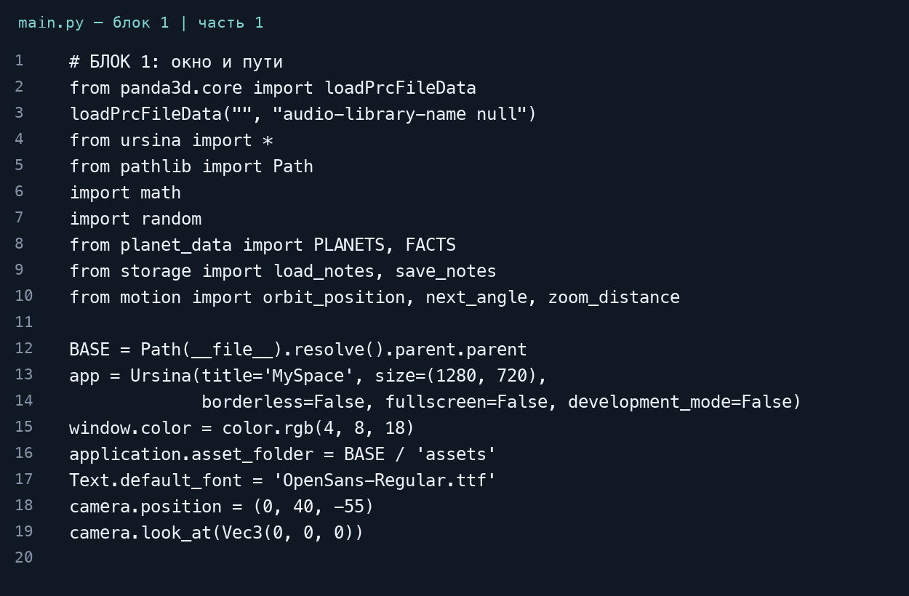

```bash
python src/main.py
```

**Результат:** пустое окно MySpace. Закройте его крестиком. Не добавляйте остальные блоки до успешного запуска.

**Зафиксируйте результат:**

```bash
git status
git add src/main.py assets docs
git commit -m "Открыть окно и подготовить текстуры"
git push -u origin HEAD
```

Если проверка не пройдена, исправьте текущий шаг перед переходом дальше. Не делайте пустой коммит ради отметки.

Теперь вставьте блок 2 перед `app.run()`:

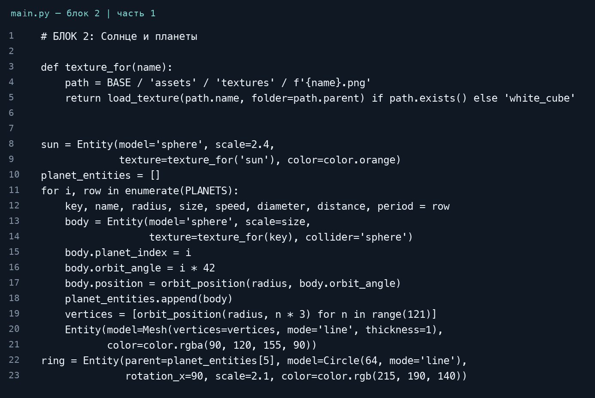

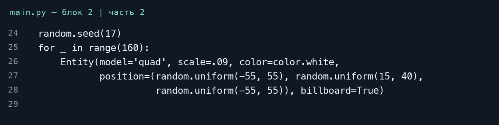

Запустите снова. **Результат:** Солнце, восемь неподвижных планет, орбиты, кольцо Сатурна и звёзды. Движения и выбора пока нет — это ожидаемо. Если изображение не найдено, появляется светлая заглушка.

Закончите спринт 1: покажите сцену, объясните создание объектов циклом, обновите фактический отчёт и задачи.

**Зафиксируйте результат:**

```bash
git status
git add src/main.py docs
git commit -m "Собрать статическую Солнечную систему"
git push -u origin HEAD
```

Если проверка не пройдена, исправьте текущий шаг перед переходом дальше. Не делайте пустой коммит ради отметки.

### 2.6. Камера и элементы интерфейса

Вставьте блок 3 перед `app.run()`. Пока новая карточка скрыта, а кнопок выбора ещё нет. Режим заметки и управление будут подключены следующими блоками.

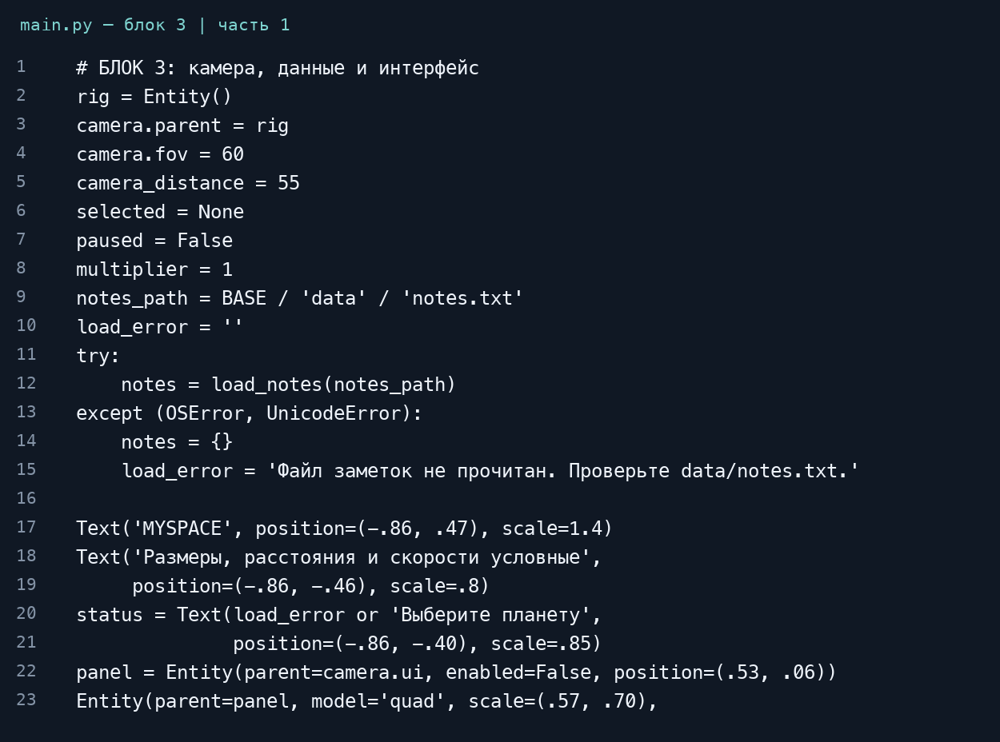

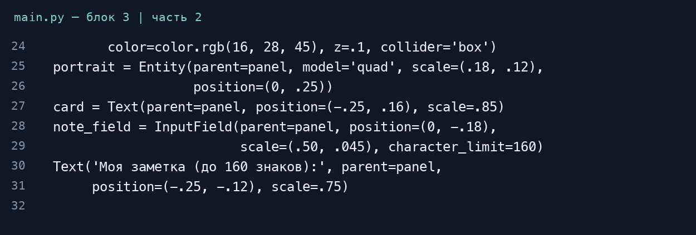

**Результат:** окно открывается с заголовком и подсказками. На промежуточном шаге камера ещё не настраивается функцией `update`, поэтому вид сцены может быть неудобным. Нормально, если пока не видны все планеты.

**Зафиксируйте результат:**

```bash
git status
git add src/main.py docs
git commit -m "Добавить элементы интерфейса"
git push -u origin HEAD
```

Если проверка не пройдена, исправьте текущий шаг перед переходом дальше. Не делайте пустой коммит ради отметки.

### 2.7. Действия и сохранение

Вставьте блок 4. Функции объявлены, но пользовательские кнопки будут добавлены на следующем шаге.

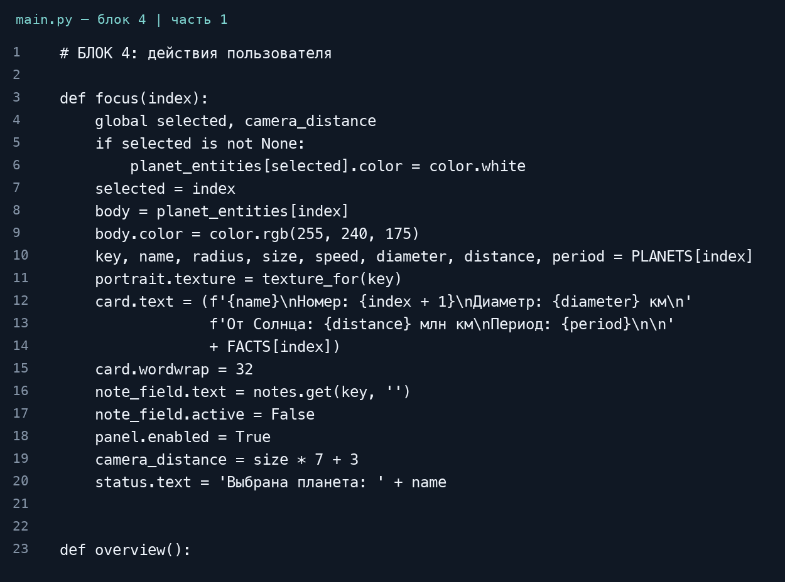

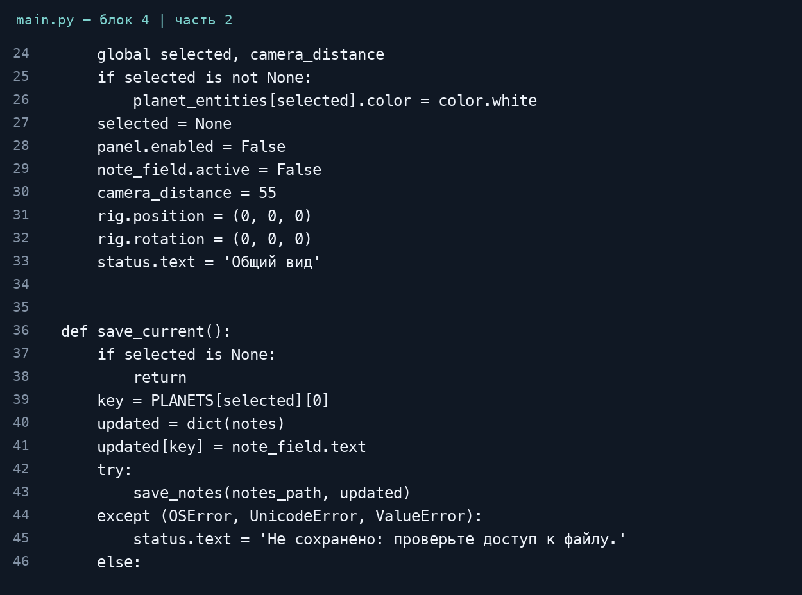

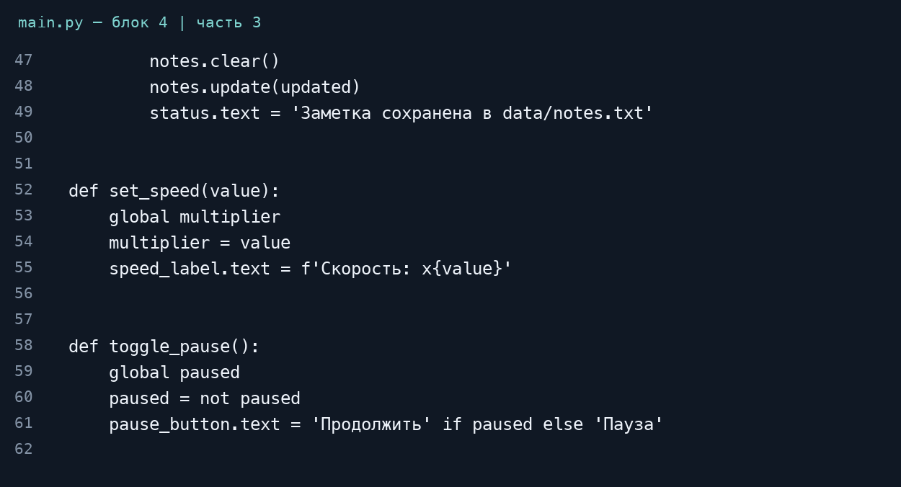

**Проверка:** программа запускается без ошибки. Объясните связь `selected`, номера в списке и ключа заметки; найдите обработку ошибки сохранения. `global` нужен для изменения переменных уровня модуля; это учебное упрощение, которое можно заменить классом после освоения версии.

**Зафиксируйте результат:**

```bash
git status
git add src/main.py docs
git commit -m "Описать выбор планеты и сохранение заметок"
git push -u origin HEAD
```

Если проверка не пройдена, исправьте текущий шаг перед переходом дальше. Не делайте пустой коммит ради отметки.

### 2.8. Подключение кнопок

Вставьте блок 5:

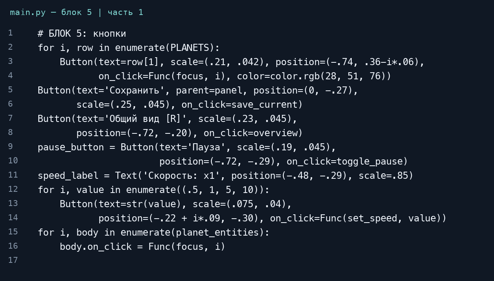

**Результат:** кнопка «Земля» открывает её карточку. Наберите заметку и нажмите «Сохранить». Появляется `data/notes.txt`. Камера и движение пока не настроены: это следующий шаг.

Проверьте файл в редакторе: есть строка с `earth|`. Закройте и запустите программу, выберите Землю — заметка восстановилась. Затем проверьте `git status`: личный TXT не должен попасть в коммит.

**Зафиксируйте результат:**

```bash
git status
git add src/main.py docs
git commit -m "Связать кнопки с действиями"
git push -u origin HEAD
```

Если проверка не пройдена, исправьте текущий шаг перед переходом дальше. Не делайте пустой коммит ради отметки.

### 2.9. Движение и управление камерой

Вставьте блок 6 перед последним `app.run()`:

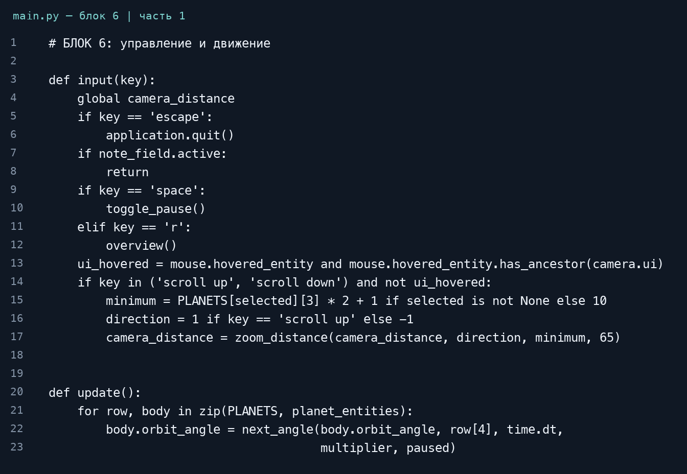

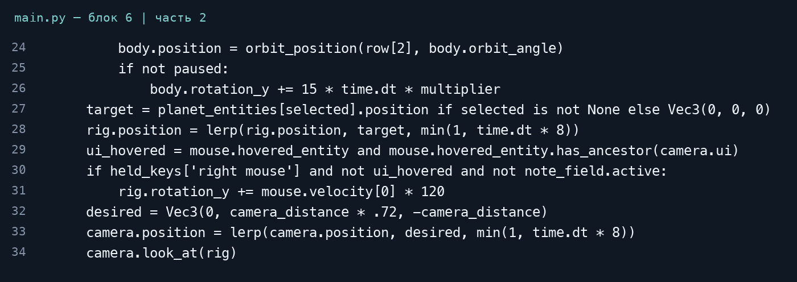

**Результат:** система движется, общий вид вмещает планеты, камера следует за выбранной планетой. Проверьте кнопки скорости, паузу, R, колесо и поворот правой кнопкой мыши.

Пауза хранится в нашей переменной, а не останавливает весь движок: поэтому можно выбирать объекты и писать заметки. В поле ввода пробел и буква R должны оставаться текстом. Смена планеты без сохранения теряет несохранённый текст — это документированное ограничение.

**Скриншот:** общий вид → всё окно, планеты и управление → `screenshots/01-system.png`. Выберите Землю → видны карточка и планета → `screenshots/02-earth-card.png`. Введите и сохраните заметку → видно подтверждение → `screenshots/03-note-saved.png`.

Вставьте в свой README относительные ссылки на эти изображения стандартным Markdown. Например: ``. Откройте README на платформе и проверьте отображение.

Завершите спринт 2: демонстрация функций, отчёт, сравнение плана и факта, обновление руководства и перечня рисков.

**Зафиксируйте результат:**

```bash
git status
git add src/main.py screenshots docs README.md
git commit -m "Завершить движение камеру и заметки"
git push -u origin HEAD
```

Если проверка не пройдена, исправьте текущий шаг перед переходом дальше. Не делайте пустой коммит ради отметки.

## Шаг 3. Тестирование

### 3.1. Проверки расчётов и TXT

Создайте `tests/test_logic.py`, наберите код. Здесь используется встроенный `unittest`, дополнительная библиотека не нужна.

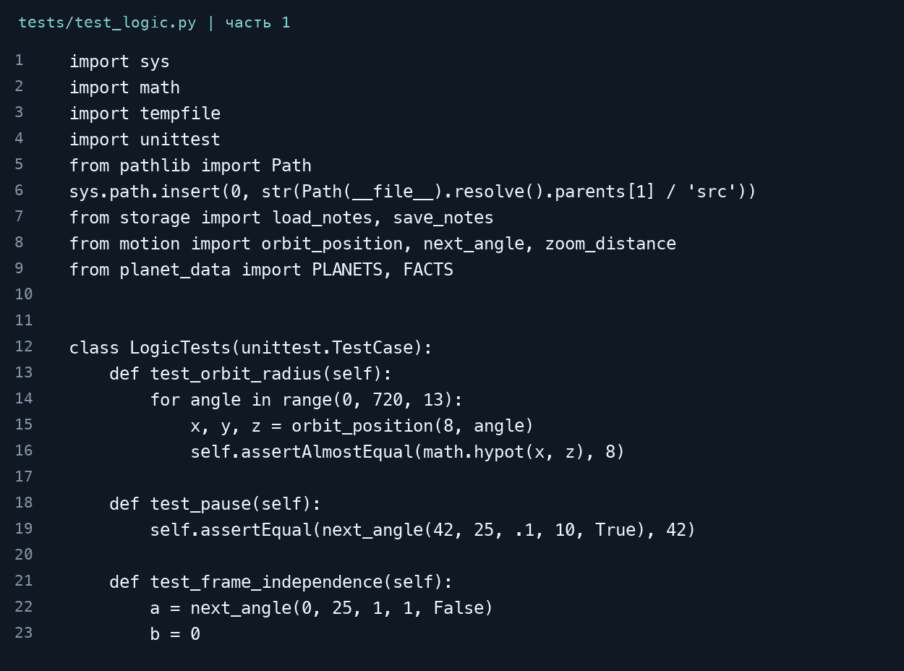

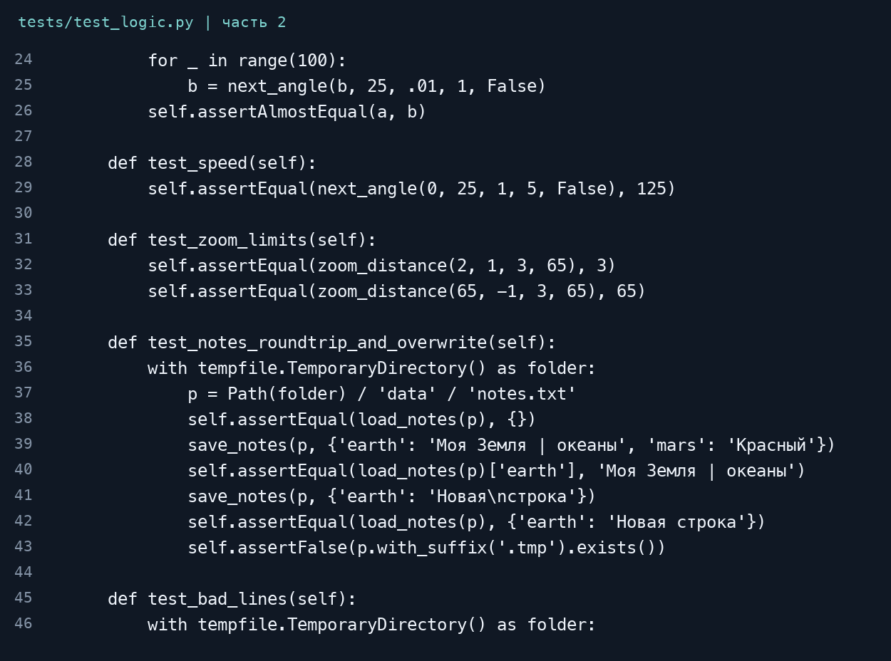

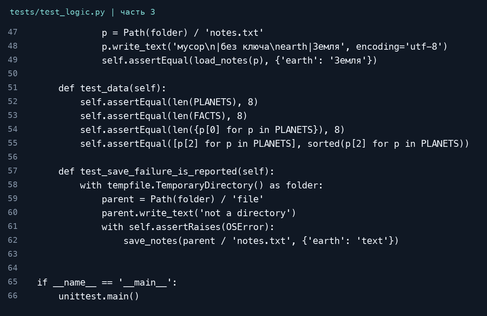

В корне проекта:

```bash
python -m unittest discover -s tests -v
```

Ожидается 9 успешных тестов. Они проверяют расчёты и чтение/запись временных файлов, **но не доказывают работоспособность графического интерфейса**. Личные заметки этими тестами не меняются.

Если тест не прошёл, сравните ожидаемый и фактический результат, найдите ошибку, исправьте её и повторите проверку. Не изменяйте ожидаемый результат только ради зелёного статуса.

**Зафиксируйте результат:**

```bash
git status
git add tests docs
git commit -m "Проверить расчёты и TXT автоматическими тестами"
git push -u origin HEAD
```

Если проверка не пройдена, исправьте текущий шаг перед переходом дальше. Не делайте пустой коммит ради отметки.

### 3.2. Проверки интерфейса руками

Создайте `tests/manual_checks.md`. Для каждого пункта запишите дату, ОС, действие, ожидаемый и **фактический** результат, пройдено/не пройдено, ссылку на дефект.

1. Запуск: окно 1280 × 720, Солнце и восемь планет, читаемые подписи.
2. Все восемь кнопок: карточка соответствует имени, изображению и данным выбранной планеты.
3. Клик по сфере: выбирается именно эта планета; нажатие на карточку не выбирает объект за ней.
4. Масштаб: многократно прокрутите колесо в обе стороны; камера не попадает внутрь планеты, общий вид восстанавливается R.
5. Поворот: удерживайте правую кнопку и перемещайте мышь; центр выбранной планеты остаётся целью камеры.
6. Пауза: запомните положение, подождите 5 секунд — планеты стоят, интерфейс работает.
7. Скорости: последовательно выберите 0.5, 1, 5, 10; движение меняется, подпись соответствует значению.
8. Заметка: Земля → «Моя заметка R с пробелами» → сохранить → выход → запуск → Земля. Текст восстановлен; R и пробел не управляли сценой во время ввода.
9. Разные планеты: сохраните разные тексты Земле и Марсу — они не подменяют друг друга. Очистите заметку и сохраните — пустое значение сохраняется.
10. Отмена несохранённого изменения: измените текст, не сохраняйте, выберите другую планету и вернитесь. Доступен ранее сохранённый текст.
11. Нет TXT: закройте приложение, сохраните резервную копию файла вне проекта и уберите исходный файл. Запуск работает; новое сохранение создаёт файл. Верните свои данные при необходимости.
12. Нет текстуры: временно переименуйте `earth.png`; запустите. Заглушка вместо текстуры, без аварийного завершения. Верните имя. Локальные временные переименования не коммитьте.
13. Ошибка записи: на тестовой копии проекта сделайте вместо `data/notes.tmp` папку с таким именем. Сохранение должно показать ошибку. Удалите только созданную тестовую папку и проверьте успешное сохранение снова.
14. Длительная работа: 10 минут движения, выбора, пауз и ввода — нет закрытия с ошибкой. Измерьте FPS, запишите характеристики ПК; целевой ориентир — 30 FPS, отклонение фиксируйте честно.
15. Другой каталог запуска: запустите по полному пути к `src/main.py`, находясь в другой папке. Текстуры и заметки по-прежнему берутся из проекта.

**Дефект:** номер → действия → ожидание → факт → серьёзность → исправление → повторная проверка. Задачу не закрывайте до повторной проверки. После изменения кода обновите его описание в документах и устаревшие скриншоты.

**Зафиксируйте результат:**

```bash
git status
git add tests docs screenshots README.md
git commit -m "Записать фактические проверки интерфейса"
git push -u origin HEAD
```

Если проверка не пройдена, исправьте текущий шаг перед переходом дальше. Не делайте пустой коммит ради отметки.

### 3.3. Проверка на другом компьютере

Попросите одногруппника клонировать **ваш** репозиторий в новую папку. Он создаёт новое окружение, устанавливает зависимости по README и выполняет основной сценарий. Не передавайте свою `.venv` и не подсказывайте отсутствующие шаги устно.

Зафиксируйте: кто проверял, какая ОС, версии, команды, что получилось, где потребовалась помощь. Если помощь нужна — исправьте README и повторите затронутую часть проверки. На чистой копии заметок сначала нет; после сохранения они появляются локально.

## Шаг 4. Публикация и защита

### 4.1. Приведите документы к фактическому состоянию

- Устав: достигнута ли цель, что принято заказчиком.
- План: фактические сроки и часы, причины изменений, зависимости и критические задачи.
- Требования и ТЗ: соответствуют именно созданной версии; каждое FR имеет проверку.
- Протоколы: только состоявшиеся обсуждения и принятые решения.
- Отчёты: три спринта, план/факт, риски, готовность и выводы.
- Руководство: точные команды, управление, ограничение несохранённых заметок, ошибки и их решения.
- README: назначение, ФИО, функции, стек и проверенные версии, структура, установка, запуск, скриншоты, результаты тестов, ограничения, источники и улучшения.

Напишите три извлечённых урока: что оценили неверно, что помогло и что измените в следующем проекте. Согласуйте итог с преподавателем и запишите решение о приёмке.

### 4.2. Проверьте Git и опубликуйте версию

Сначала сохраните проверенную версию в своей ветке и согласуйте слияние:

```bash
git status
git add .
git commit -m "Завершить проверку MySpace"
git push -u origin HEAD
```

Если новых изменений нет, коммит пропускается. Для индивидуального проекта после проверки объедините ветки:

```bash
git switch main
git pull --ff-only
git merge --no-ff feature/solar-system
git push -u origin main
```

Если уже слили запрос через интерфейс платформы, повторный merge не нужен: переключитесь на main и выполните pull. При конфликте остановитесь, разберите обе версии, проверьте результат и только после этого продолжайте.


```bash
git status
git diff
git add README.md docs tests screenshots src requirements.txt assets .gitignore
git commit -m "Подготовить MySpace v1.0 к приёмке"
git push
git tag -a v1.0 -m "MySpace: учебная версия 1.0"
git push origin v1.0
```

Если новых изменений нет, повторный коммит не нужен. Не пересоздавайте существующий тег без разбора причины. В интерфейсе платформы при наличии функции оформите релиз по тегу. Откройте ссылки и изображения; личных заметок, паролей и `.venv` в репозитории нет.

### 4.3. Что показать на защите

Запуск из репозитория → общий вид → выбор Земли → масштаб → пауза → заметка → перезапуск → сохранённая заметка. Покажите историю коммитов и один исправленный дефект.

Объясните путь данных: кнопка → выбранная планета → поле → сохранение → TXT → загрузка. По просьбе преподавателя измените параметр скорости или текст карточки, запустите и проверьте результат. Объём README и число коммитов не заменяют эту проверку.

## Если возникла ошибка

- `ModuleNotFoundError: ursina` — проверьте активное окружение и установку зависимостей тем же Python.
- `ModuleNotFoundError: planet_data` — проверьте имя файла и его расположение рядом с main.py.
- `IndentationError` — сравните отступы со снимком; используйте четыре пробела, не смешивайте с табуляцией.
- `SyntaxError` — проверьте кавычки, скобки, двоеточия; номера строк с картинок не вводятся.
- Окно открывается и сразу закрывается — запускайте из терминала и прочитайте полный текст ошибки.
- Белая планета — проверьте имя PNG и папку `assets/textures/`, затем перезапустите.
- Заметка не записалась — нажмите «Сохранить», проверьте сообщение и доступ к каталогу `data/`.
- Появился конфликт при `git pull` — сначала `git status`; разберите отмеченные изменения, согласуйте итог, проверьте приложение, затем завершите слияние. Не используйте принудительный push как универсальное решение.

## Правила использования ИИ

Можно просить объяснить одну строку, ошибку или небольшой фрагмент. Перед вопросом напишите номер шага, ожидание, фактический результат и приложите текст ошибки. После ответа сначала проверьте изменение, затем объясните его своими словами. Не поручайте ИИ переписать весь проект или создать фиктивные отчёты.

**Документация и Git после каждого изменения:** что обновлено, какая проверка пройдена, нужен ли новый скриншот, какой результат зафиксирован. При отсутствии изменений так и напишите в рабочей записи.

## Где используются знания проектного менеджмента

- Инициация: устав, проблема, заказчик, пользователи и границы.
- Жизненный цикл: согласование → планирование → три итерации разработки → контроль → завершение.
- Методология: учебная итерационная разработка и Kanban-доска; объясните отличие от последовательного Waterfall и почему один студент не изображает полную команду Scrum.
- Тройное ограничение: объём, срок и ресурсы. Дополнительная функция требует пересмотра оценки.
- Планирование: WBS, зависимости, диаграмма Ганта, критический путь и оценка часов.
- Команда: распределённые роли одного исполнителя, ответственность и цель каждого спринта. Выберите личный способ поддерживать регулярную работу.
- Управление: реестр рисков с вероятностью, влиянием, мерой и ответственным; качество через проверки; ресурсы и стоимость отдельно от трудозатрат.
- Коммуникации: согласования и протоколы. Изменения: причина → влияние на сроки и объём → решение → обновлённые документы.
- Контроль: доска задач, план/факт, готовность и учебный расчёт PV/EV/AC в часах.
- Завершение: независимый запуск, приёмка, тег выпуска и извлечённые уроки.

## Результаты проверки преподавателем

Проверенный эталон, версии среды и ограничения проверки приводятся ниже после обкатки. Это относится к эталону, а не автоматически ко всем набранным студентами копиям.

Использованы Python 3.13.15, Ursina 8.3.0, Panda3D 1.10.16, Pillow 13.0.0. В свой `requirements.txt` внесите:

```text
ursina==8.3.0
panda3d==1.10.16
pillow==13.0.0
```

- Установка пакетов и `pip check`: успешно.
- 9 тестов расчётов и TXT: успешно.
- Шесть промежуточных сборок кода в порядке README: сцена создаётся без исключений во внеэкранном режиме.
- Создание сцены в программном внеэкранном режиме: успешно; восемь объектов, данные восьми карточек, скорость, пауза, сохранение и повторное чтение заметки, общий вид, выполнение кадров проверены вызовами функций.
- Найденные при обкатке ошибки исправлены до создания изображений кода: передача пути в загрузчик текстур и шрифт без кириллицы; оконный режим задан явно.
- **Полноценная проверка графического окна не завершена:** среда выполнения аварийно завершает движок на этапе определения мониторов macOS. Внеэкранная проверка использовала тестовую замену этого обращения и программный рендерер; это не подтверждает работу мыши, внешний вид, FPS и 10 минут стабильной работы в обычном окне.
- Нативный запуск и проверка на другом компьютере остаются обязательными перед массовой выдачей задания. Учебный эталон не помечен как полностью принятый продукт.

Преподавателю: сначала выполните пункты 3.2–3.3 на доступном учебном ПК. Найденные проблемы внесите в журнал, затем скорректируйте инструкцию. Студенты фиксируют собственные фактические результаты независимо от результатов эталона.
