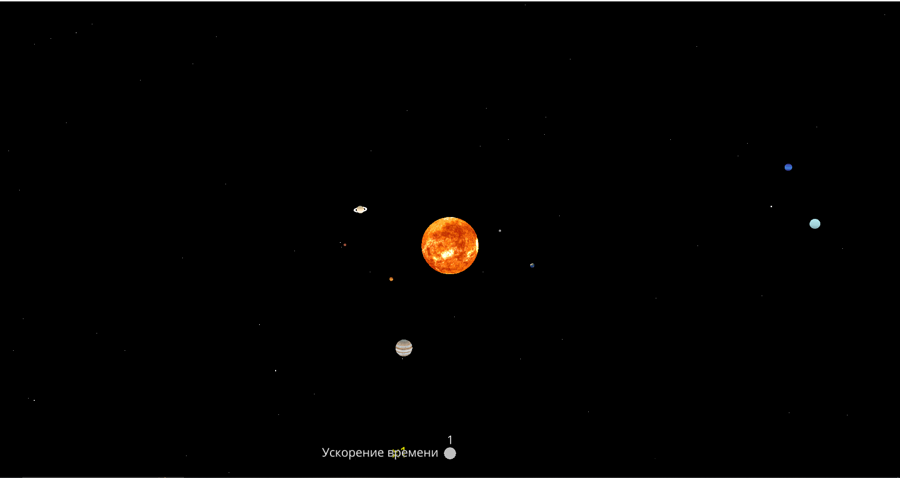

# Техническое задание
## Интерактивный симулятор Солнечной системы «MySpace»

**Разработчик:** [ФИО, группа].

**Заказчик:** учебный центр «MySpace».

**Срок:** 3 спринта по 2 недели.

## 1. Назначение проекта

Разработать настольное приложение для знакомства с Солнечной системой. Пользователь наблюдает движение планет, приближает изображение и нажимает на планету, чтобы узнать о ней больше.

Приложение предназначено для студентов, школьников и преподавателей. Предоставленный скриншот используется как ориентир оформления: тёмный космический фон, Солнце, планеты с изображениями и управление скоростью времени.

### Прототип интерфейса



Прототип показывает общее оформление. Карточки планет, удобный выбор объектов и управление камерой реализуются в рамках проекта. Это изображение-ориентир, а не подтверждение готовности приложения.

## Учебная версия по пошаговой инструкции

Актуальный порядок сборки и фиксированный состав учебной версии — в [README](../README.md): сначала семь документов, затем код с изображений, проверки и выпуск. Студенты создают свои репозитории; готовые Python-исходники в репозитории преподавателя не публикуются.

Дополнение FR-9: для выбранной планеты вводится заметка до 160 символов, сохранение выполняется кнопкой в UTF-8 файл `data/notes.txt` в формате `идентификатор|текст`. При перезапуске сохранённый текст загружается. Ошибки чтения/записи сообщаются пользователю; несохранённые изменения при смене планеты или выходе теряются. Личные заметки исключены из Git.

Учебные текстуры условные, не фотографические. Кольцо Сатурна в первой версии — контур. Управление временем выполнено кнопками вместо слайдера. Источники и различия с исходным прототипом указаны в README.

## 2. Технологический стек

- **Python** — язык программирования.
- **Ursina** — трёхмерная сцена, объекты, интерфейс и управление камерой.
- **math** — расчёт движения планет по орбитам.
- **random** — декоративный звёздный фон.
- **pathlib.Path** — пути к изображениям и другим ресурсам.
- **os** — при необходимости; обязательного использования всех импортов не требуется.

База данных, сервер и интернет во время работы не нужны. Сведения о планетах можно хранить в списке словарей Python. Проверенные совместимые версии Python и Ursina фиксируются в README и requirements.txt после первого успешного запуска.

## 3. Функциональные требования

### FR-1. Отображение Солнечной системы

При запуске отображаются Солнце и восемь планет: Меркурий, Венера, Земля, Марс, Юпитер, Сатурн, Уран и Нептун. Планеты расположены в правильном порядке удаления от Солнца.

### FR-2. Изображения планет

Солнце и каждая планета представлены объёмными сферами с соответствующими текстурами — изображениями, нанесёнными на поверхность. Сатурн дополнительно имеет кольца.

Изображения загружаются из папки проекта. Для каждой текстуры указываются источник и условия использования. Скриншот прототипа не заменяет отдельные текстуры: их нужно подобрать и добавить в assets/textures/.

### FR-3. Движение

Планеты движутся вокруг Солнца и вращаются вокруг своей оси. Ближние планеты совершают оборот быстрее дальних.

Движение рассчитывается с учётом времени между кадрами, чтобы скорость не зависела напрямую от частоты кадров.

### FR-4. Приближение и отдаление

Колесо мыши изменяет расстояние камеры до выбранной планеты, а в общем режиме — до центра системы.

Ограничить приближение и отдаление: камера не должна попадать внутрь планеты или уходить на расстояние, с которого система становится неразличимой.

### FR-5. Выбор планеты

При нажатии левой кнопкой мыши на изображение планеты в сцене:

- планета выделяется;
- камера плавно переводит её в центр обзора;
- открывается информационная карточка;
- камера продолжает удерживать выбранную планету в центре при её движении.

Для выбора маленьких планет предусмотреть список кнопок с названиями восьми планет. Нажатие кнопки выполняет то же действие, что и нажатие на планету.

### FR-6. Информационная карточка

Карточка содержит название, отдельное изображение, порядковый номер от Солнца, диаметр в километрах, среднее расстояние от Солнца в миллионах километров, период обращения с указанием единиц, краткое описание и один интересный факт.

При выборе другой планеты содержимое карточки обновляется. Источники справочных сведений указываются в документации.

### FR-7. Управление временем

Добавить паузу и выбор скорости: **×0,5, ×1, ×5, ×10**. Текущее значение видно на экране.

На паузе движение и вращение планет останавливаются, но выбор объектов, карточки и управление камерой продолжают работать.

### FR-8. Возврат к общему виду

Кнопка «Общий вид» возвращает камеру в исходное положение, закрывает карточку и снимает выделение. На экране снова видна вся система.

## 4. Интерфейс и управление

Основную часть окна занимает космическая сцена. По краям размещаются список планет и карточка выбранного объекта. Снизу — управление временем и краткая подсказка.

- **Левая кнопка мыши** — выбрать планету.
- **Колесо мыши** — приблизить или отдалить.
- **Правая кнопка мыши с перетаскиванием** — повернуть обзор вокруг текущего центра.
- **Пробел** — пауза или продолжение.
- **R** — общий вид.
- **Esc** — закрыть приложение.

Нажатия на элементы интерфейса не должны одновременно выбирать планеты за ними. Прокрутка над информационной карточкой не должна менять масштаб сцены.

## 5. Упрощения модели

Это учебная визуальная модель. Размеры планет и расстояния допускается изменять для удобства просмотра. Орбиты могут быть круговыми и находиться в одной плоскости. Скорости подбираются для наглядности; множитель времени относится к анимации. Гравитационные взаимодействия и столкновения рассчитывать не требуется.

На экране или в справке указать: **«Размеры, расстояния и скорости изменены для наглядности»**.

## 6. Надёжность и качество

- После установки зависимостей приложение работает без интернета.
- Пути к ресурсам вычисляются относительно расположения проекта; абсолютные пути разработчика не используются.
- При отсутствии изображения показывается цветная сфера или заглушка, приложение продолжает работать.
- Текст карточек читается и не выходит за границы окна при разрешении 1280 × 720.
- Приложение работает на учебном компьютере не менее 10 минут без аварийного завершения.
- Ориентир — не менее 30 кадров в секунду при общем обзоре; характеристики проверенного компьютера фиксируются в README.

## 7. Структура репозитория

```text
myspace-solar-system/
├── src/
│   ├── main.py
│   ├── planets_data.py
│   ├── solar_system.py
│   └── interface.py
├── assets/
│   ├── textures/
│   └── images/
├── docs/
│   ├── technical_specification.md
│   └── prototype.png
├── screenshots/
├── tests/
│   └── manual_checks.md
├── README.md
├── requirements.txt
└── .gitignore
```

Это целевая структура: исходный код ещё предстоит написать. Разделение кода на файлы можно уточнить. В ходе работы дополнить docs/ уставом, планом, требованиями, протоколами, отчётами о статусе и документацией продукта.

## 8. План разработки

Порядок выполнения задания и контроль понимания описаны в [пошаговом маршруте](learning_route.md). Начните с пересказа задачи и планирования, затем переходите к небольшим работающим частям.

### Спринт 1 — Солнечная система на экране

Подготовить первоначальные документы, создать сцену, добавить Солнце, восемь планет, текстуры и движение.

**Результат:** запускается анимированная модель с узнаваемыми планетами.

### Спринт 2 — взаимодействие

Реализовать приближение, поворот камеры, выбор планет, информационные карточки и возврат к общему виду.

**Результат:** можно выбрать любую планету, рассмотреть её и прочитать описание.

### Спринт 3 — завершение и публикация

Добавить управление временем, обработку отсутствующих ресурсов, провести проверки, обновить документацию и скриншоты, опубликовать v1.0.

**Результат:** другой человек запускает приложение по инструкции из репозитория.

Каждый спринт длится 2 недели. В конце — демонстрация и отчёт о статусе.

## 9. Критерии приёмки

1. Отображаются Солнце и все восемь планет с соответствующими изображениями.
2. Планеты движутся, пауза и все множители скорости работают.
3. Каждую планету можно выбрать мышью и кнопкой из списка.
4. Карточка показывает сведения именно о выбранной планете.
5. Приближение ограничено, камера не попадает внутрь объекта.
6. На паузе интерфейс и камера остаются доступными.
7. Кнопка общего вида восстанавливает исходный обзор.
8. Отсутствие одной текстуры не приводит к закрытию программы.
9. Ручные проверки и фактические результаты записаны в tests/manual_checks.md.
10. Проект запускается на другом компьютере по README.

## 10. Требования к публикации

В репозитории должны находиться исходный код, необходимые изображения, зависимости с проверенными версиями и актуальная документация.

README содержит описание, проверенную версию Python, команды установки и запуска, управление, ограничения модели и скриншоты общего вида и карточки планеты.

После значимых изменений обновляются соответствующие документы и изображения. Перед сдачей проверяются установка из чистой копии репозитория, относительные ссылки и отображение скриншотов.
